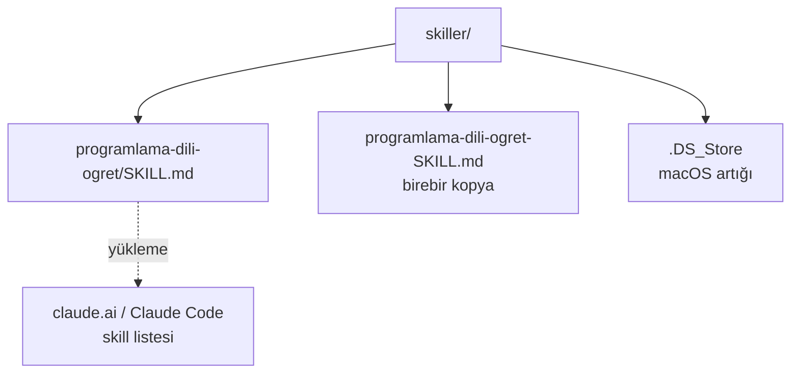
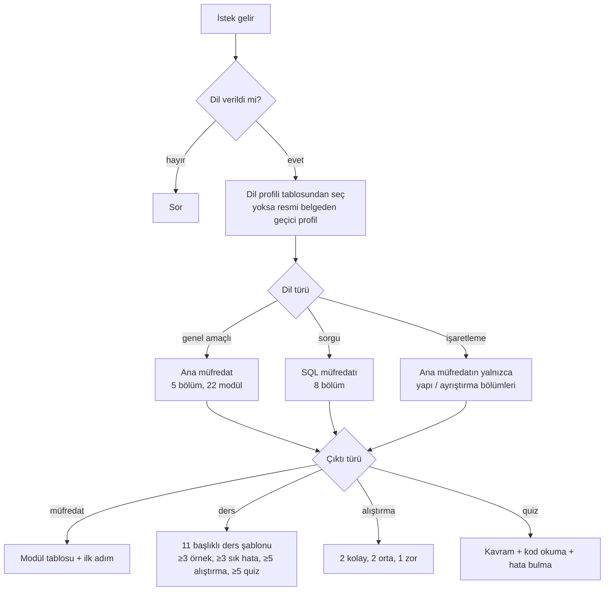

# skiller — Mimari ve İşleyiş

## 1. Genel bakış
Claude skill'lerinin kaynak deposu. Her skill `<skill-adı>/SKILL.md` biçiminde kendi klasöründe durur. Kod yok; içerik Claude'a verilen talimatlardır. Skill'in ne zaman tetikleneceğini YAML ön bilgisindeki `description` belirler, gövde ise tetiklendikten sonra uygulanacak kurallardır.

## 2. Mimari

## 3. Dosyalar ve görevleri
| Dosya | Görevi | Kimden çağrılır | Neyi çağırır |
|---|---|---|---|
| `programlama-dili-ogret/SKILL.md` | Herhangi bir dili müfredat / ders / alıştırma / quiz biçiminde öğreten skill (342 satır, ~22,7 KB) | Claude, `description` eşleşince veya `/programlama-dili-ogret` | — |
| `programlama-dili-ogret-SKILL.md` | Yukarıdakinin bayt bayt aynısı (`cmp` ile doğrulandı) | — | — |
| `.DS_Store` | macOS Finder artığı, yanlışlıkla commit'lenmiş | — | — |

## 4. Ana akışlar — `programlama-dili-ogret`

- **İlk ders her zaman kurulum:** işletim sistemi + ortam sorulur, sürüm çıktısı alınmadan modüle geçilmez.
- **Derinlik:** Düzey 1–4; varsayılan Düzey 2. "Akademik mod" = 6 katman (sözdizimi, anlam, çalışma modeli, veri/bellek, tasarım gerekçesi, formal temel).
- **Kaynak verilirse:** kaynağın sırası korunur, dışarıdan eklenenler "Kaynak dışı ek" diye işaretlenir.

## 5. Veri
Veri tabanı yok. Skill içindeki "veri" tablolardır: dil profili (8 dil), kurulum araç kataloğu, ortam karşılaştırması.

## 6. Bilinen kısıtlar ve notlar (09.11.2026 analizi)
**Depo düzeyi**
- Kökteki `programlama-dili-ogret-SKILL.md`, klasördeki SKILL.md'nin birebir kopyası; ileride biri güncellenip diğeri unutulursa ayrışır.
- `.DS_Store` commit'lenmiş, `.gitignore` yok.
- Kurulu skill'in (claude.ai'deki) açıklaması "Herhangi bir programlama dili öğreneceği zaman bu skille başvurulması gerekiyor." — depodaki `description` ise daha uzun ve farklı. Kurulu sürüm depoyla aynı değil.

**SKILL.md biçimi**
- Bölüm başlıkları (`Başlamadan önce`, `Öğretmen kuralları`, `Müfredat` …) Markdown başlığı değil, düz satır; tek `#` başlıklar yalnızca ders şablonunda (~291–327). Zengin metinden yapıştırılmış gibi görünüyor.
- "Girdileri topla" tablosu (~16–22) sekmeyle yazılmış, `|` tablosu değil.
- Satır 7–10: ön bilgiden sonra gövdede ikinci bir `Name` / `Description` bloğu var; bu ikinci açıklama tetiklemede kullanılmaz, ön bilgidekiyle de aynı değil ("ne zaman kullanma" kuralı yalnızca burada).

**SKILL.md içerik tutarlılığı**
- "Her dilde ilk ders kurulumdur" (~121) ↔ müfredatta 1. modül "Dili tanıma", kurulum 2. modül.
- Varsayılan Düzey 2 "mantık + üç örnek" diyor, sık hatalar Düzey 3'te; ama ders kuralları her modülde ≥3 sık hata istiyor. Ayrıca "normal seviye" ifadesi (~282) Düzey sistemiyle eşleştirilmemiş.
- Dil profili alanları test aracı, biçimlendirici, statik analiz, belge adresi içermeli diyor (~27); tabloda yalnızca 5 sütun var.
- "Derinleşmek için" araç tablosu (~166–172) tamamen C++'a özgü; dilden bağımsız skill'de diğer diller için karşılık yok.
- Açıklamada Swift, Kotlin geçiyor; profil tablosunda yoklar (kural gereği araştırılarak eklenir, hata değil).

## 7. Hızlı yön bulma (hangi iş → nereye bakılır)
| Konu | Dosya | Bölüm (yaklaşık satır) |
|---|---|---|
| Tetikleme açıklaması | `programlama-dili-ogret/SKILL.md` | ön bilgi (1–4) |
| Girdiler (dil, seviye, çıktı…) | 〃 | Başlamadan önce (~14–22) |
| Dil profili tablosu | 〃 | ~29–42 |
| Dil türü / akademik mod | 〃 | ~44–59 |
| Konu işleme, derinlik, kod kuralları | 〃 | ~61–88 |
| Öğretmen kuralları, dile uyarlama | 〃 | ~90–118 |
| Kurulum rehberi ve araç kataloğu | 〃 | ~120–195 |
| Ana müfredat (5 bölüm) | 〃 | ~197–231 |
| Evrensel konu haritası | 〃 | ~233–251 |
| SQL müfredatı | 〃 | ~253–264 |
| Çıktı türleri | 〃 | ~266–288 |
| Ders şablonu | 〃 | ~290–326 |
| Kaynak, sunum, örnek | 〃 | ~328–342 |
