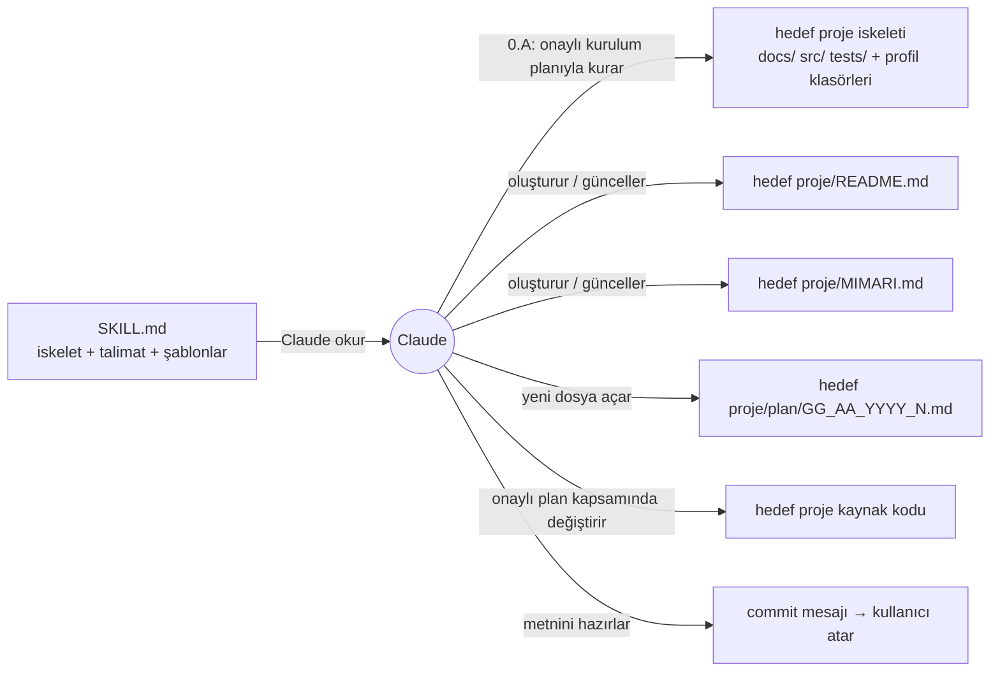
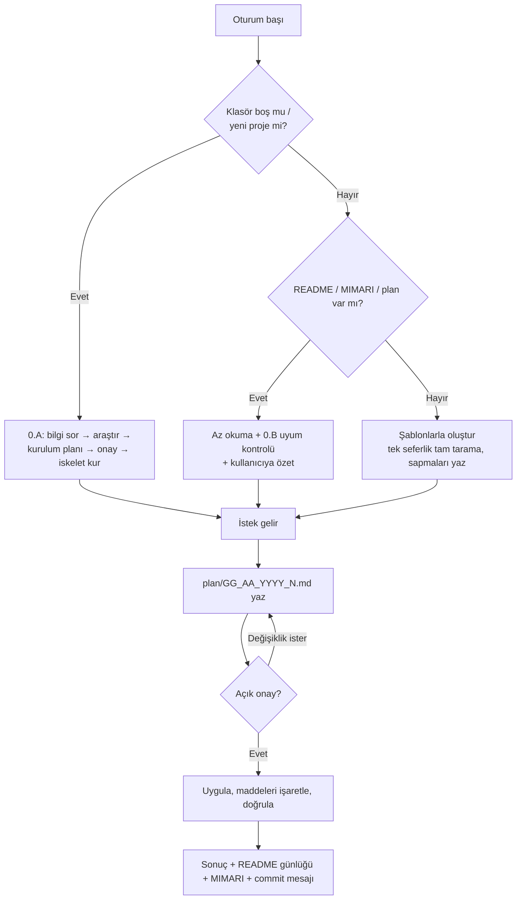

# proje (skill) — Mimari ve İşleyiş

## 1. Genel bakış
`proje`, Claude'un bir proje klasöründe nasıl çalışacağını belirleyen bir skill. Amacı:
- Her projeyi **aynı standart iskeletle** kurmak: çekirdek klasörler (● öğeler) her projede açılır, ek klasörler (○ öğeler) proje türüne göre ve yalnızca sabit adlarla açılır.
- Her projede **aynı kayıt düzenini** kurmak: `README.md` (tanım ve günlük), `MIMARI.md` (projenin hafızası), `plan/` (tarihli planlar).
- Her değişikliği **plan → açık onay → uygulama → kayıt** sırasıyla yürütmek ve geriye dönük izlenebilir kılmak.
- Token tasarrufu sağlamak: Claude projeyi her oturumda baştan taramaz, kayıt dosyalarını okur.

Kapsam: tek bir dosya (`SKILL.md`). Kod çalıştırmaz. Claude'a talimat ve şablon verir.

## 2. Mimari

## 3. Dosyalar ve görevleri
| Dosya | Görevi | Kimden çağrılır | Neyi çağırır |
|---|---|---|---|
| `SKILL.md` | Skill'in tamamı: ön bilgi (name, description), standart iskelet, çalışma kuralları, şablonlar | Claude (description eşleşince veya kullanıcı `/proje` deyince) | — |
| `README.md` | Bu skill çalışmasının tanımı ve değişiklik günlüğü | Oturum başında Claude | — |
| `MIMARI.md` | Bu dosya: skill'in yapısı ve akışı | Oturum başında Claude | — |
| `plan/` | Bu skill üzerindeki değişikliklerin planları | Oturum başında Claude (açık planlar) | — |

## 4. Ana akışlar / algoritmalar

### 4.1 Skill'in hedef projede çalışma akışı
1. **Oturum başı (§0):** proje klasörü belirlenir.
   - **Klasör boşsa veya kullanıcı yeni proje başlatıyorsa → 0.A Yeni proje kurulumu:** proje adı, amaç, dil ve proje türü sorulur. Dilin/çerçevenin resmî düzeni, adlandırma stili, `.gitignore` ve `.editorconfig` değerleri araştırılır (internete bağlanmadan önce sorulur). Kurulum planı yazılır ve onaylanır. Ardından ● öğeler ve profilin ○ öğeleri kurulur, boş klasörlere `.gitkeep` konur. README ve MIMARI doldurulur, araştırma `docs/research/setup.md`'ye yazılır. `git init` önerilir, günlüğe "Proje kuruldu" kaydı eklenir.
   - **Kayıtlar varsa:** "az okuma" yapılır: MIMARI'nin tamamı, README'nin son 3 günlük kaydı, `- [ ]` içeren planlar. **0.B Uyum kontrolü** yapılır: kökteki liste standartla ve MIMARI'deki sapma tablosuyla karşılaştırılır, yeni fark yalnızca raporlanır. Ardından kullanıcıya özet verilir. Eski `TASARIM.md` veya kurala uymayan plan adları bulunursa onayla düzeltilir.
   - **Dosyalar var, kayıtlar yoksa:** kayıtlar şablonlarla oluşturulur. Tam proje taraması yalnızca bu adımda yapılır. Gerçek ağaç ve sapmalar MIMARI §2'ye yazılır, hiçbir şey taşınmaz.
2. **Plan (§1):** `plan/GG_AA_YYYY_N.md` açılır. "Neden yapılıyor" ve "Neyi değiştirecek" bölümleri zorunlu, her maddede ayrıca Neden ve Ne değişecek satırları var. Açık onay beklenir.
3. **Uygula (§2):** yalnızca plandaki işler yapılır. Biten madde `[x]` olarak işaretlenir ve mümkünse doğrulanır.
4. **Kapat (§3):** planın Sonuç bölümü doldurulur. README günlüğünün en üstüne kayıt eklenir, gerekiyorsa MIMARI güncellenir, commit mesajı verilir (commit'i kullanıcı atar).

## 5. Veri
Skill'in hedef projede ürettiği kayıtlar ve kuralları:

| Kayıt | Kural |
|---|---|
| Standart iskelet | ● öğeler her projede: README.md, MIMARI.md, plan/, docs/ (+ docs/research/), src/, tests/, .gitignore, .gitattributes, .editorconfig. ○ öğeler gerektiğinde, yalnızca sabit adlarla. Kurulumda proje türü profiline göre ek ○ öğeler açılır. |
| Adlandırma | Klasör ve yeni dosya adları İngilizce, küçük harf, boşluksuz, Türkçe karaktersiz. Kod dosyaları dilin stil kılavuzuna göre. Kayıt katmanı adları (README.md, MIMARI.md, plan/) değişmez. |
| Üretilen dosyalar | `build/`, `dist/`, `logs/`, `tmp/`, `.env`, bağımlılık klasörleri. Hepsi `.gitignore`'da. |
| Standarttan sapmalar | Hedef projenin MIMARI.md §2'sindeki tablo: `Klasör / dosya | Standart | Bu projede | Neden`. 0.B kontrolü bu tabloya göre "yeni fark" arar. |
| Karar kayıtları | Büyük kararlar `docs/decisions/0001-short-title.md` (Bağlam / Seçenekler / Karar / Sonuçlar). README günlüğünde bağlantı. Ayrı CHANGELOG yok. |
| Plan dosya adı | `plan/GG_AA_YYYY_N.md`. Tarih sistemden alınır, N o günün sıra numarasıdır (en büyük + 1). Konu dosya adında değil, ilk satırdaki başlıkta yazar. |
| Plan durumu | `Onay bekliyor` → `Onaylandı` → `Tamamlandı` |
| Açık plan | İçinde `- [ ]` geçen plan. Oturum başında yalnızca bunlar okunur. |
| README günlüğü | Yeni kayıt en üste eklenir, eskiler asla silinmez, kayıt başına ~10 satır. Oturum başında son 3 kayıt okunur. |
| MIMARI.md | Yapının "tek kaynağı". 7 bölüm; §2'de klasör düzeni ve sapma tablosu, §7 "Hızlı yön bulma" tablosu. |

## 6. Bilinen kısıtlar ve notlar
- **Giderildi (13.11.2026, plan 12_11_2026_1):** standart proje iskeleti eksikliği, yeni proje akışının olmaması ve zayıf `description`.
- **Tek dile bağlı örnekler:** `php -l`, `stok_ozet.php`, `cekiListesiID` gibi örnekler bir PHP projesinden geliyor (MIMARI şablonu §5, plan örneği, §2 doğrulama). Kullanıcının "skill'ler genel olsun" tercihiyle çelişiyor. Sonraki plan önerisi.
- **Silme kuralı farkı:** skill "silmeden önce sor" diyor. Kullanıcı tercihine göre ise silme işlemini Claude hiç yapmaz, yalnızca komutu verir. Sonraki plan önerisi.
- **Diğer bekleyen öneriler:** iskelete `CLAUDE.md` eklemek; şablonları ayrı dosyalara taşıyıp `SKILL.md`'yi (301 satır) kısaltmak.
- **0.A araştırma sırası:** araştırma özeti önce kurulum planına girer, `docs/research/setup.md` onaydan sonra yazılır.
- **Claude skill profili:** skill projelerinde Anthropic düzeni (`SKILL.md` kökte; `scripts/`, `references/`, `assets/`) çerçeve istisnası olarak uygulanır. Kayıt katmanı yine eklenir.
- Yüklü kopya claude.ai'den senkronize geliyor. Buradaki düzenleme kullanıcı yeniden yükleyene kadar etkin olmaz.

## 7. Hızlı yön bulma (hangi iş → nereye bakılır)
| Konu | Dosya | Bölüm (yaklaşık satır) |
|---|---|---|
| Ön bilgi (name, description) | `SKILL.md` | 1–4 |
| Başlık ve amaç | `SKILL.md` | (~7) |
| Standart proje iskeleti (ağaç) | `SKILL.md` | (~12), ağaç (~18–51) |
| Proje türü profilleri | `SKILL.md` | (~53) |
| İskelet kuralları (kök, üretilen dosyalar, adlandırma, testler, kararlar, istisna) | `SKILL.md` | (~66) |
| Oturum başı | `SKILL.md` | §0 (~76) |
| Yeni proje kurulumu | `SKILL.md` | 0.A (~90) |
| Uyum kontrolü | `SKILL.md` | 0.B (~101) |
| Az okuma kuralları | `SKILL.md` | (~105) |
| Plan yazma ve onay | `SKILL.md` | §1 (~128), adlandırma (~140) |
| Uygulama kuralları | `SKILL.md` | §2 (~152) |
| Kapanış: günlük, mimari, commit | `SKILL.md` | §3 (~160) |
| Kesin kurallar (izinler) | `SKILL.md` | (~170) |
| README şablonu | `SKILL.md` | (~181) |
| MIMARI şablonu | `SKILL.md` | (~206), klasör düzeni ve sapmalar (~217) |
| Plan şablonu ve örnek | `SKILL.md` | (~244), örnek (~282) |
| Commit mesajı şablonu | `SKILL.md` | (~292) |
