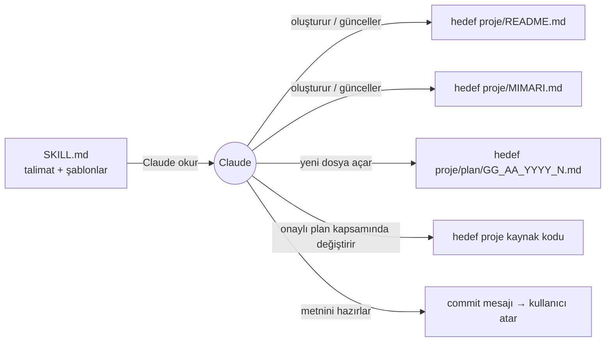
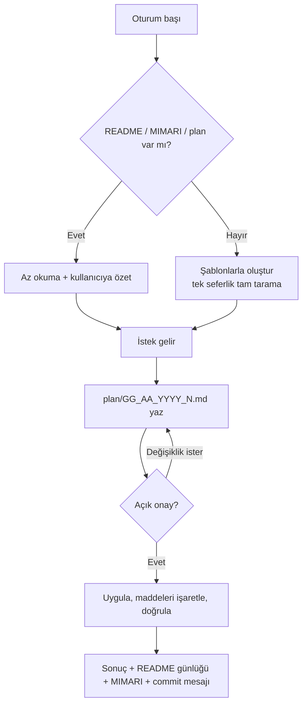

# proje (skill) — Mimari ve İşleyiş

## 1. Genel bakış
`proje`, Claude'un bir proje klasöründe nasıl çalışacağını belirleyen bir skill. Amacı:
- Her projede **aynı kayıt düzenini** kurmak: `README.md` (tanım ve günlük), `MIMARI.md` (projenin hafızası), `plan/` (tarihli planlar).
- Her değişikliği **plan → açık onay → uygulama → kayıt** sırasıyla yürütmek ve geriye dönük izlenebilir kılmak.
- Token tasarrufu sağlamak: Claude projeyi her oturumda baştan taramaz, kayıt dosyalarını okur.

Kapsam: tek bir dosya (`SKILL.md`). Kod çalıştırmaz. Claude'a talimat ve şablon verir.

## 2. Mimari

## 3. Dosyalar ve görevleri
| Dosya | Görevi | Kimden çağrılır | Neyi çağırır |
|---|---|---|---|
| `SKILL.md` | Skill'in tamamı: ön bilgi (name, description), çalışma kuralları, şablonlar | Claude (description eşleşince veya kullanıcı `/proje` deyince) | — |
| `README.md` | Bu skill çalışmasının tanımı ve değişiklik günlüğü | Oturum başında Claude | — |
| `MIMARI.md` | Bu dosya: skill'in yapısı ve akışı | Oturum başında Claude | — |
| `plan/` | Bu skill üzerindeki değişikliklerin planları | Oturum başında Claude (açık planlar) | — |

## 4. Ana akışlar / algoritmalar

### 4.1 Skill'in hedef projede çalışma akışı (mevcut sürüm)
1. **Oturum başı (§0):** proje klasörü belirlenir. `README.md`, `MIMARI.md` ve `plan/` aranır.
   - Varsa "az okuma" yapılır: MIMARI tamamı, README'nin son 3 günlük kaydı, `- [ ]` içeren planlar. Ardından kullanıcıya özet verilir. Eski `TASARIM.md` veya kurala uymayan plan adları bulunursa onayla düzeltilir.
   - Yoksa şablonlarla oluşturulur. Tam proje taraması yalnızca bu adımda yapılır.
2. **Plan (§1):** `plan/GG_AA_YYYY_N.md` açılır. "Neden yapılıyor" ve "Neyi değiştirecek" bölümleri zorunlu, her maddede ayrıca Neden ve Ne değişecek satırları var. Açık onay beklenir.
3. **Uygula (§2):** yalnızca plandaki işler yapılır. Biten madde `[x]` olarak işaretlenir ve mümkünse doğrulanır.
4. **Kapat (§3):** planın Sonuç bölümü doldurulur. README günlüğünün en üstüne kayıt eklenir, gerekiyorsa MIMARI güncellenir, commit mesajı verilir (commit'i kullanıcı atar).

## 5. Veri
Skill'in hedef projede ürettiği kayıtlar ve kuralları:

| Kayıt | Kural |
|---|---|
| Plan dosya adı | `plan/GG_AA_YYYY_N.md`. Tarih sistemden alınır, N o günün sıra numarasıdır (en büyük + 1). Konu dosya adında değil, ilk satırdaki başlıkta yazar. |
| Plan durumu | `Onay bekliyor` → `Onaylandı` → `Tamamlandı` |
| Açık plan | İçinde `- [ ]` geçen plan. Oturum başında yalnızca bunlar okunur. |
| README günlüğü | Yeni kayıt en üste eklenir, eskiler asla silinmez, kayıt başına ~10 satır. Oturum başında son 3 kayıt okunur. |
| MIMARI.md | Yapının "tek kaynağı". 7 bölüm, 7. bölüm "Hızlı yön bulma" tablosu. |

## 6. Bilinen kısıtlar ve notlar
- **Standart proje iskeleti yok:** skill yalnızca kayıt dosyalarını standartlaştırıyor. `src/`, `tests/` gibi klasör düzeni projeden projeye değişiyor. Kullanıcının asıl hedefi olan "her proje aynı mimaride" henüz karşılanmıyor. Bu iş için: `plan/12_11_2026_1.md`.
- **Yeni proje akışı yok:** §0 her zaman var olan bir projeyi varsayıyor. Boş klasörde proje başlatma adımları tanımlı değil.
- **description zayıf:** `"sadece klasörler için geçerli"`. Claude skill'i ne zaman açacağına bu metinle karar verdiği için skill kendiliğinden tetiklenmeyebilir.
- **Tek dile bağlı örnekler:** `php -l`, `stok_ozet.php`, `cekiListesiID` gibi örnekler bir PHP projesinden geliyor. Kullanıcının "skill'ler genel olsun" tercihiyle çelişiyor.
- **Silme kuralı farkı:** skill "silmeden önce sor" diyor. Kullanıcı tercihine göre ise silme işlemini Claude hiç yapmaz, yalnızca komutu verir.
- Yüklü kopya claude.ai'den senkronize geliyor. Buradaki düzenleme kullanıcı yeniden yükleyene kadar etkin olmaz.

## 7. Hızlı yön bulma (hangi iş → nereye bakılır)
| Konu | Dosya | Bölüm (yaklaşık satır) |
|---|---|---|
| Ön bilgi (name, description) | `SKILL.md` | 1–4 |
| Oturum başı / ilk kurulum | `SKILL.md` | §0 (~12) |
| Az okuma kuralları | `SKILL.md` | (~24) |
| Plan yazma ve onay | `SKILL.md` | §1 (~47), adlandırma (~59) |
| Uygulama kuralları | `SKILL.md` | §2 (~71) |
| Kapanış: günlük, mimari, commit | `SKILL.md` | §3 (~79) |
| Kesin kurallar (izinler) | `SKILL.md` | (~89) |
| README şablonu | `SKILL.md` | (~100) |
| MIMARI şablonu | `SKILL.md` | (~125) |
| Plan şablonu ve örnek | `SKILL.md` | (~155), örnek (~193) |
| Commit mesajı şablonu | `SKILL.md` | (~203) |
