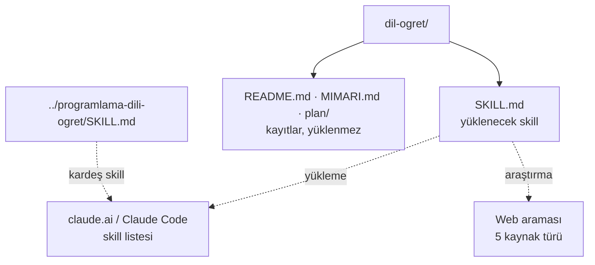
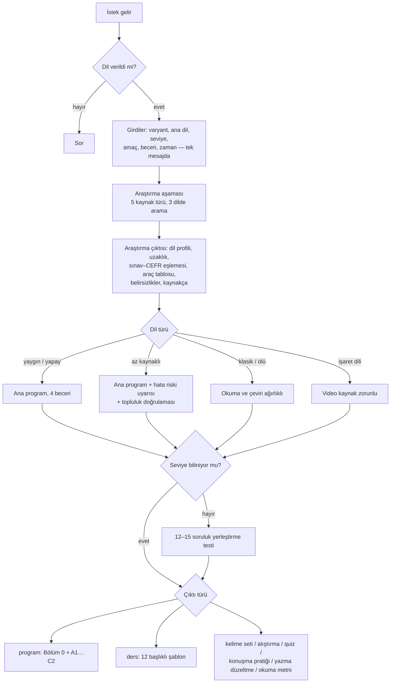

# dil-ogret — Mimari ve İşleyiş

## 1. Genel bakış
Dünyadaki herhangi bir insan dilini öğreten Claude skill'i. Kod yok, içerik Claude'a verilen talimatlardır. Skill'in ne zaman tetikleneceğini YAML ön bilgisindeki `description` belirler. Gövde, tetiklendikten sonra uygulanacak kurallardır. Skill dilden bağımsızdır: dil hakkındaki bilgi skill'de tutulmaz, her istekte araştırılır.

## 2. Mimari

**Tetikleme ayrımı:**
- `dil-ogret` açıklamasında "Programlama dilleri için kullanma" cümlesi var.
- `programlama-dili-ogret` açıklaması ise programlama ve sorgu dillerini sayar.
- Bu sayede iki skill aynı "dil öğret" isteği için yarışmaz.

**Yükleme notu:** claude.ai'ye yüklenecek olan yalnızca `SKILL.md`'dir. Klasör zip'lenerek yüklenecekse kayıt dosyaları dışarıda bırakılmalıdır.

## 3. Dosyalar ve görevleri
| Dosya | Görevi | Kimden çağrılır | Neyi çağırır |
|---|---|---|---|
| `SKILL.md` | Herhangi bir insan dilini (yaşayan, az kaynaklı, klasik, yapay, işaret dili) öğreten skill. Öğretim araştırmaya dayanır, CEFR seviyelerine göre yapılır. Çıktılar: program, ders, kelime seti, alıştırma, seviye testi, konuşma ve yazma pratiği, okuma metni. 330 satır, ~23,7 KB | Claude, `description` eşleşince veya `/dil-ogret` | Web araması (araştırma aşaması) |
| `README.md` | Kısa tanım ve değişiklik günlüğü | — | — |
| `MIMARI.md` | Bu dosya | — | — |
| `plan/GG_AA_YYYY_N.md` | Onaylı planlar | — | — |

## 4. Ana akış

- **Araştırma her dilde zorunludur.**
  - Dil konuşmada ilk kez isteniyorsa tam araştırma yapılır.
  - Sonraki konularda yalnızca o konuya odaklı araştırma yapılır.
  - Web erişimi yoksa bilgi "doğrulanmadı" diye işaretlenir.
- **Seviye:** CEFR Pre-A1–C2 (2020 Companion Volume). Dilin kendi sınavı araştırmayla CEFR'e eşlenir.
- **Öğretim ilkeleri:** §5'te listelenir. Her ilkenin dayandığı meta-analiz veya ikinci dil edinimi (SLA) çalışması "Dayanak" sütununda yazılıdır.
- **Ses yok:** Claude ses üretemez. Telaffuz IPA ve dış ses kaynaklarıyla verilir.
- **Geri bildirim:** Konuşma sırasında düzeltilmiş tekrar (recast) yapılır. Sonunda en önemli 3 hata açıkça anlatılır.

## 5. Veri
Veri tabanı yok, dile özgü sabit veri de yok. SKILL.md'deki tablolar dilden bağımsızdır:
- kaynak türleri
- dil türü uyarlaması
- öğretim ilkeleri
- konu ve dil bilgisi haritaları
- çıktı türleri

## 6. Bilinen kısıtlar ve notlar
- Skill gerçek bir istekle çalıştırılarak test edilmedi, tetiklenme oranı da ölçülmedi.
- §5'teki dayanaklar çoğunlukla arama özetleri ve ikincil kaynaklardan doğrulandı, asıl makalelerin tam metni okunmadı. Etki büyüklükleri skill'e yazılmadı. Kaynak listesi plan/09_11_2026_1.md §5'te.
- FSI resmî sayfası (state.gov) erişime kapalıydı (403). FSI koşulları ikincil kaynaktan alındı.
- `programlama-dili-ogret` açıklamasında "insan dilleri için kullanma" yönünde bir cümle yok. Bu ekleme o skill'in kendi planına bırakıldı.

## 7. Hızlı yön bulma (hangi iş → nereye bakılır)
| Konu | Dosya | Bölüm (yaklaşık satır) |
|---|---|---|
| Tetikleme açıklaması | `SKILL.md` | ön bilgi (1–4) |
| Girdiler (dil, varyant, seviye, amaç…) | 〃 | §1 (~20–34) |
| Araştırma aşaması, kaynak türleri, araştırma çıktısı | 〃 | §2 (~36–96) |
| Dil türü uyarlaması (az kaynaklı, klasik, işaret dili…) | 〃 | §3 (~98–106) |
| CEFR seviyeleri, yerleştirme testi | 〃 | §4 (~108–133) |
| Öğretim ilkeleri ve dayanakları | 〃 | §5 (~135–151) |
| Program iskeleti, konu ve dil bilgisi haritaları | 〃 | §6 (~153–204) |
| Çıktı türleri | 〃 | §7 (~206–217) |
| Ders şablonu ve derinlik kuralları | 〃 | §8 (~219–270) |
| Telaffuz, yazı, geri bildirim | 〃 | §9 (~272–288) |
| Doğruluk, sunum, örnekler | 〃 | §10–12 (~290–330) |
