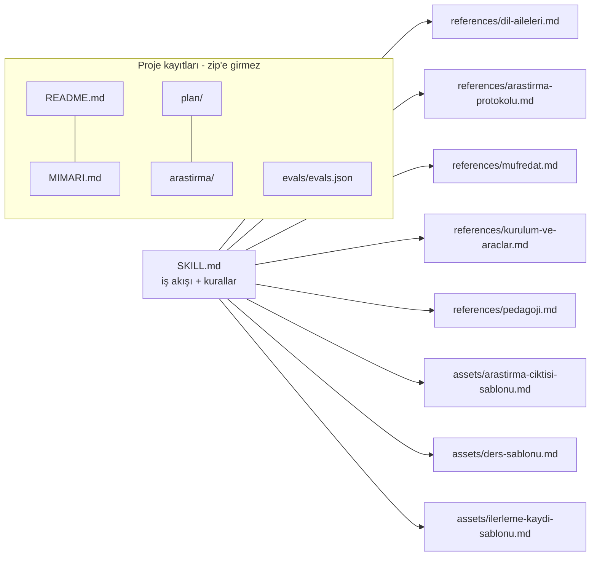
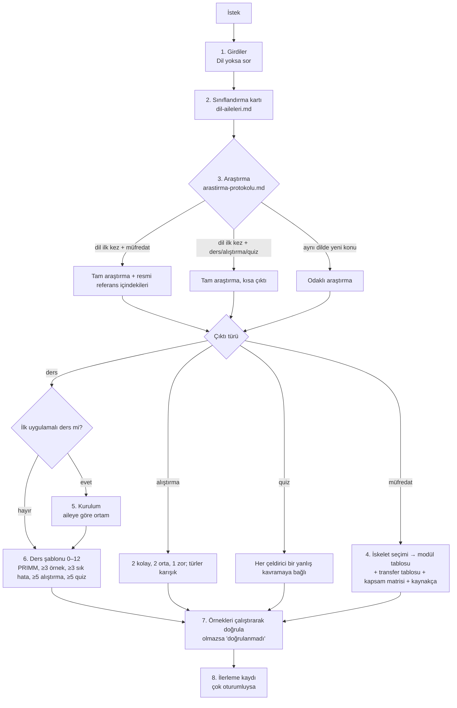

# programlama-dili-ogret — Mimari ve İşleyiş

## 1. Genel bakış
Claude'a verilen talimatlardan oluşan bir skill; kod içermez. Skill'in ne zaman tetikleneceğini `SKILL.md` ön bilgisindeki `description` belirler.

13.11.2026'dan beri skill "B mimarisi" ile çalışır (plan 12_11_2026_1):
- Kısa bir `SKILL.md`: iş akışı ve kurallar.
- Gerektiğinde okunan başvuru dosyaları (`references/`).
- Doldurulan şablonlar (`assets/`).

Skill hiçbir dile bağlı değildir. Her dil için önce araştırma yapar, dili 19 aileden birine veya birkaçına sınıflar ve kaynakçalı bir program kurar.

## 2. Mimari

- Bütün başvuru dosyalarına doğrudan `SKILL.md`'den bağlantı verilir; bağlantılar tek seviyedir. Başvuru dosyaları birbirine Markdown bağlantısı vermez, yalnızca adla anar.
- Kayıt dosyalarına skill'in hiçbir yerinden başvurulmaz.

## 3. Dosyalar ve görevleri
| Dosya | Görevi | Ne zaman okunur | Satır |
|---|---|---|---|
| `SKILL.md` | Ön bilgi, 8 adımlı iş akışı, girdiler, öğretmen kuralları, derinlik ve akademik mod, kod kuralları, çıktı türleri, 3 örnek | Skill her tetiklendiğinde | 189 |
| `references/dil-aileleri.md` | Sınıflandırma kartı, aile seçimi kuralları, 19 aile (kavramsal makine, ekle/çıkar, yanlış kavramalar, gözlem, kurulum) | 2. adım: dil ilk kez geçtiğinde | 336 |
| `references/arastirma-protokolu.md` | Araştırmanın ne zaman ve ne kadar yapılacağı, kaynak türleri, arama kalıpları, kaynak değerlendirme, az kaynaklı diller, içindekiler çıkarma, kod doğrulama döngüsü | 3. adım | 105 |
| `references/mufredat.md` | İskelet seçimi, 22 modül, Bölüm 6 (23–30), kavram ağı, kapsam matrisi, sorgu müfredatı | 4. adım | 163 |
| `references/kurulum-ve-araclar.md` | Kurulum rehberi, aileye göre ortam farkları, 8 dillik profil örnekleri, araç ve derleyici kataloğu | 5. adım | 115 |
| `references/pedagoji.md` | Konu işleme şekli, PRIMM, alıştırma türleri, quiz çeldiricileri, aralıklı tekrar, transfer tablosu, seviye dengesi, üstbiliş | 6. adım; müfredatta transfer tablosu için §6 | 169 |
| `assets/arastirma-ciktisi-sablonu.md` | Araştırma çıktısının biçimi (kart, profil, araçlar, etki, transfer, kapsam, belirsizlik, kaynakça) | 3. adım | 80 |
| `assets/ders-sablonu.md` | Ders başlıkları 0–12 | 6. adım | 65 |
| `assets/ilerleme-kaydi-sablonu.md` | Çok oturumlu öğrenme kaydı | 8. adım | 45 |
| `evals/evals.json` | 5 değerlendirme senaryosu (Go, Verilog, Forth, SQL JOIN, Lean 4) | Kayıt; skill okumaz | — |
| `README.md`, `MIMARI.md`, `plan/`, `arastirma/` | Proje kaydı | İnsan / Claude (oturum başı) | — |

## 4. Ana akış

- **İskelet seçimi:**
  - Aile 1 → ana müfredat.
  - Aile 4 → sorgu müfredatı.
  - Aile 5 → yalnızca yapı, ayrıştırma ve doğrulama modülleri.
  - Diğer aileler → ana müfredat + ailenin "Ekle" ve "Çıkar / uyarla" maddeleri.
- **Kurulum:** Önce işletim sistemi ve ortam sorulur; ailesi donanım gerektiren dillerde donanım da. Sürüm çıktısı alınmadan modüle geçilmez.
- **Derinlik:** Düzey 1–4, varsayılan Düzey 2. Akademik modda 6 katman kullanılır. Kavramsal makine her düzeyde kullanılır.
- **Kaynak verilirse:** Kaynağın sırası korunur, kaynak dışından eklenenler "Kaynak dışı ek" diye işaretlenir.

## 5. Veri ve sayısal kurallar
Veri tabanı yok.

**Sabit tablolar (başlangıç kataloğu, araştırmayla doğrulanır):**
- 8 dillik profil
- genel araçlar
- dil bazlı derleyiciler
- ortam karşılaştırması
- aileye göre ortam farkları
- 19 aile
- 22 modülün varsayılan ön koşulları

SQL araç tablosu ile C++ "Derinleşmek için" tablosu 13.11.2026'da kaldırıldı.

**Sayılar:**
- Ders: ≥3 örnek, ≥3 sık hata, ≥5 alıştırma, ≥5 quiz.
- Alıştırma seti: 2 kolay, 2 orta, 1 zor; en az 3 farklı tür.
- Geri çağırma: her ders başında 2–3 soru.
- Tekrar aralıkları: 1 gün → 3 gün → 1 hafta → 2 hafta → 1 ay (pratik başlangıç değeri).
- Tam araştırmada asgari kaynak: 3 birincil, 2 akademik, 2 topluluk.

**Ön bilgi:** `name` = klasör adı. `description` 603 karakter (sınır 1.024). Tetikleme için gereken bilgi ilk 200 karakterde.

## 6. Bilinen kısıtlar ve notlar
**Kapanan sorunlar** (09.11.2026 analizi; plan 12_11_2026_1 ile):
- İki farklı açıklama vardı.
- Bölüm başlıkları düz satırdı, girdi tablosu sekmeliydi.
- Araştırma ve kaynakça yoktu.
- "İlk ders kurulumdur" cümlesi 1. modülle çelişiyordu.
- Düzey 2 sık hataları içermiyordu, ders kuralı ise istiyordu.
- "Normal seviye" ifadesi tanımsızdı.
- Profil tanımındaki alanlar tabloda yoktu.
- C++'a özgü bir tablo vardı.

**Açık:**
- **Kurulu sürüm:** claude.ai'deki sürüm eski. Yeni zip'in yüklenmesi gerekiyor (README'de komut var).
- **Açıklama sınırı:** claude.ai'deki sınırın 200 mü 1.024 karakter mi olduğu belirsiz. Yükleme reddedilirse kısa bir açıklama gerekir.
- **Kurulum kuralı:** "Kurulum doğrulanmadan modül anlatımına geçilmez" kuralı, tek bir konunun anlatımını isteyen kullanıcıyı da önce kuruluma yönlendiriyor (Verilog senaryosunun kuru çalıştırmasında görüldü). Kural değiştirilmedi; karar kullanıcıda.
- **Testler:** `evals/evals.json` henüz çalıştırılmadı.
- **Aile dosyası:** `dil-aileleri.md` 336 satır. Büyürse ailelere göre bölünür, ama bağlantılar tek seviyede kalır.
- **Araç adları:** Aile dosyasındaki araç adları ve kurulum notları genel bilgiden yazıldı; tek tek kaynakla doğrulanmadı. Dosya bunları "başlangıç önerisi, araştırmayla doğrulanır" diye işaretliyor.

## 7. Hızlı yön bulma (hangi iş → nereye bakılır)
| Konu | Dosya | Bölüm (yaklaşık satır) |
|---|---|---|
| Tetikleme açıklaması | `SKILL.md` | ön bilgi (1–4) |
| İş akışı ve hangi dosyanın ne zaman okunacağı | 〃 | İş akışı (~10–34) |
| Girdiler | 〃 | ~36–45 |
| Öğretmen kuralları, yapay zekâ kuralları, dile uyarlama | 〃 | ~47–88 |
| Derinlik düzeyleri, akademik mod | 〃 | ~90–111 |
| Kod kuralları, doğrulama döngüsü | 〃 | ~113–123 |
| Çıktı türleri (müfredat, ders, alıştırma, quiz) | 〃 | ~125–154 |
| Örnekler (Go, Verilog, Forth) | 〃 | ~162–189 |
| Sınıflandırma kartı, aile seçimi | `references/dil-aileleri.md` | ~30–52 |
| Belirli bir aile | 〃 | 1: ~54 · 2: ~69 · 3: ~92 · 4: ~105 · 5: ~119 · 6: ~132 · 7: ~145 · 8: ~158 · 9: ~181 · 10: ~199 · 11: ~213 · 12: ~228 · 13: ~240 · 14: ~252 · 15: ~265 · 16: ~282 · 17: ~300 · 18: ~311 · 19: ~320 |
| Araştırmanın derinliği, kaynak türleri | `references/arastirma-protokolu.md` | §1–2 (~15–46) |
| Arama kalıpları, kaynak değerlendirme | 〃 | §3–4 (~47–72) |
| Az kaynaklı diller, içindekiler, kod doğrulama | 〃 | §5–7 (~73–98) |
| İskelet seçimi, 22 modül | `references/mufredat.md` | §1–2 (~15–63) |
| Bölüm 6 Uzmanlık | 〃 | §3 (~64–77) |
| Kavram ağı, kapsam matrisi | 〃 | §6–7 (~102–144) |
| Sorgu dili müfredatı | 〃 | §8 (~145–163) |
| Kurulum rehberi, aileye göre ortam | `references/kurulum-ve-araclar.md` | §1–2 (~14–41) |
| Profil örnekleri, araç ve derleyici tabloları | 〃 | §3–4 (~42–89) |
| Konu işleme şekli, PRIMM | `references/pedagoji.md` | §1–2 (~16–46) |
| Alıştırma türleri, quiz çeldiricileri | 〃 | §3–4 (~47–98) |
| Aralıklı tekrar, transfer tablosu, seviye, üstbiliş | 〃 | §5–8 (~99–157) |
| Ders, araştırma çıktısı, ilerleme kaydı biçimi | `assets/*.md` | — |
| Değerlendirme senaryoları | `evals/evals.json` | — |
