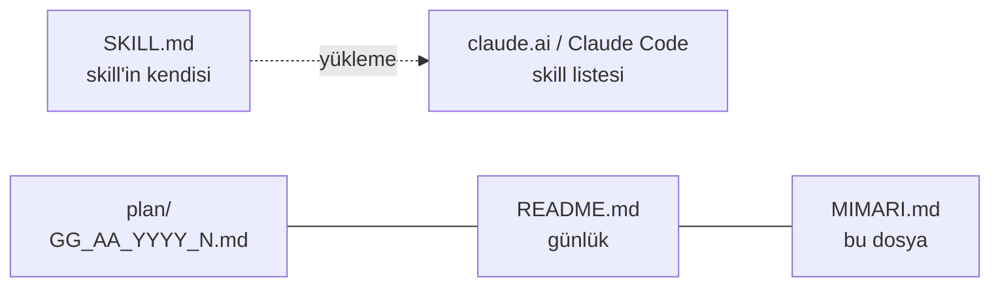
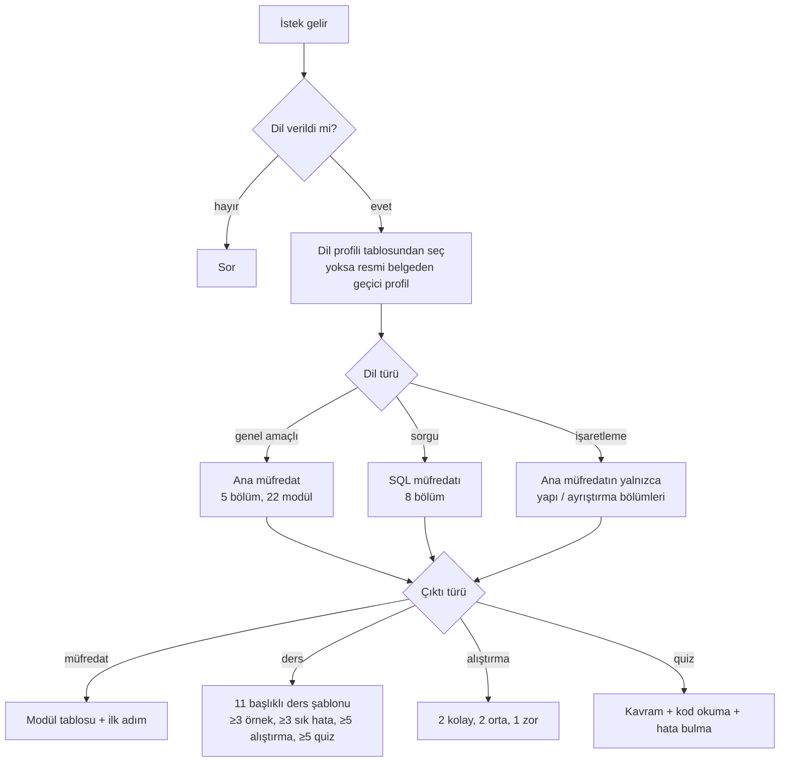

# programlama-dili-ogret — Mimari ve İşleyiş

## 1. Genel bakış
Claude'a verilen talimatlardan oluşan bir skill. Kod yok. Skill'in ne zaman tetikleneceğini `SKILL.md` ön bilgisindeki `description` belirler. Gövde, skill tetiklendikten sonra uygulanacak kurallardır: girdiler, dil türü, müfredat, ders şablonu ve öğretmen kuralları.

## 2. Mimari

`README.md`, `MIMARI.md` ve `plan/` yalnızca proje kaydıdır. `SKILL.md` bunlara başvurmaz, Claude da skill çalışırken bunları okumaz.

## 3. Dosyalar ve görevleri
| Dosya | Görevi | Kimden çağrılır | Neyi çağırır |
|---|---|---|---|
| `SKILL.md` | Skill talimatları (342 satır, ~22,7 KB) | Claude; `description` eşleşince veya `/programlama-dili-ogret` | — |
| `README.md` | Proje tanımı ve değişiklik günlüğü | İnsan / Claude (oturum başı) | — |
| `MIMARI.md` | Yapı, akış, bilinen sorunlar, yön bulma | İnsan / Claude (oturum başı) | — |
| `plan/` | Tarihli iş planları | İnsan / Claude | — |

## 4. Ana akış (mevcut `SKILL.md`)

- **Kurulum:** Önce işletim sistemi ve ortam sorulur. Sürüm çıktısı alınmadan modüle geçilmez.
- **Derinlik:** Düzey 1–4, varsayılan Düzey 2. "Akademik mod" 6 katmandan oluşur: sözdizimi, anlam, çalışma modeli, veri/bellek, tasarım gerekçesi, formal temel.
- **Kaynak verilirse:** Kaynağın sırası korunur, dışarıdan eklenenler "Kaynak dışı ek" diye işaretlenir.

## 5. Veri
Veri tabanı yok. Skill içindeki sabit tablolar:
- dil profili (8 dil)
- dilden bağımsız araçlar
- dil bazlı derleyiciler
- SQL araçları
- C++ "Derinleşmek için"
- ortam karşılaştırması

## 6. Bilinen kısıtlar ve notlar (09.11.2026 analizi)
**Kurulu sürüm**
- claude.ai'de kurulu skill'in açıklaması "Herhangi bir programlama dili öğreneceği zaman bu skille başvurulması gerekiyor." Bu dosyadaki `description` ise farklı. Kurulu sürüm bu dosyayla aynı değil.

**Biçim**
- Bölüm başlıkları Markdown başlığı değil, düz satır. Tek `#` başlıklar yalnızca ders şablonunda (~291–327).
- "Girdileri topla" tablosu (~16–22) `|` ile değil sekmeyle yazılmış.
- Satır 7–10'da ön bilgiden sonra ikinci bir `Name`/`Description` bloğu var. Tetiklemede kullanılmıyor. "Ne zaman kullanma" kuralı yalnızca burada yazılı.

**İçerik**
- Skill dil bilgisini sabit tablolardan alıyor; araştırma yalnızca "dil tabloda yoksa" yapılıyor. Kaynakça istenmiyor.
- "Her dilde ilk ders kurulumdur" (~121) diyor, ama müfredatta 1. modül "Dili tanıma", kurulum 2. modül.
- Varsayılan Düzey 2'de sık hatalar yok, ders kuralları ise her modülde ≥3 sık hata istiyor. "Normal seviye" ifadesi (~282) tanımsız.
- Dil profili tanımı test, biçimlendirici, statik analiz ve belge alanlarını istiyor (~27), tabloda bunlar yok.
- "Derinleşmek için" tablosu (~166–172) yalnızca C++'a özgü.

→ Bu sorunların düzeltmesi: `plan/09_11_2026_1.md`

## 7. Hızlı yön bulma (hangi iş → nereye bakılır)
| Konu | Dosya | Bölüm (yaklaşık satır) |
|---|---|---|
| Tetikleme açıklaması | `SKILL.md` | ön bilgi (1–4) |
| Girdiler (dil, seviye, çıktı…) | 〃 | Başlamadan önce (~14–22) |
| Dil profili tablosu | 〃 | ~29–42 |
| Dil türü / akademik mod | 〃 | ~44–59 |
| Konu işleme, derinlik, kod kuralları | 〃 | ~61–88 |
| Öğretmen kuralları, dile uyarlama | 〃 | ~90–118 |
| Kurulum rehberi | 〃 | ~120–131 |
| Araç kataloğu (genel, derleyici, SQL, C++) | 〃 | ~133–172 |
| Ortam karşılaştırması, kurulum sorunları, kontrol listesi | 〃 | ~174–195 |
| Ana müfredat (5 bölüm) | 〃 | ~197–231 |
| Evrensel konu haritası | 〃 | ~233–251 |
| SQL müfredatı | 〃 | ~253–264 |
| Çıktı türleri | 〃 | ~266–288 |
| Ders şablonu | 〃 | ~290–326 |
| Kaynak, sunum, örnek | 〃 | ~328–342 |
